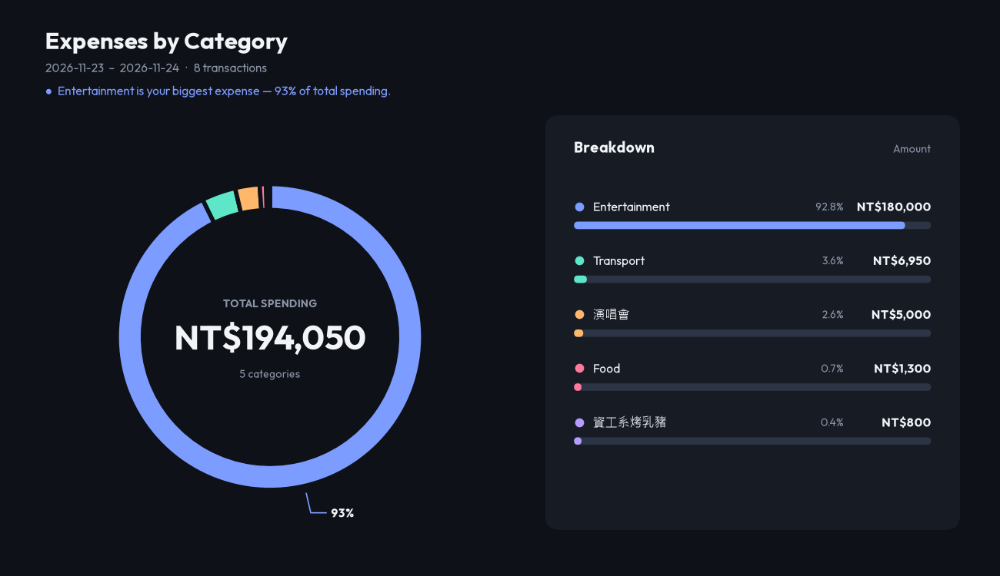

# SE_PROJECT - 命令列記帳與視覺化分析工具

本專案為 **軟體工程導論（11513470018）作業一** 的團隊協作實作成果，採用 Python 開發一套模組化的命令列記帳系統，並透過 Git 功能分支（Feature Branch）與命令列合併（Command-line Merge）完成雙人協作開發流程。

---

## 👥 團隊成員與分工

| 學號 | GitHub 帳號 | 開發分支 | 負責角色與模組功能 |
| :--- | :--- | :--- | :--- |
| **1132924 施奕良** | `@xzklxf` | `feature-input` | **組員 A**：開發消費輸入模組（`input_expense.py`），負責 CSV 檔案初始化、多筆連續輸入迴圈與金額數字防呆驗證。 |
| **1132929 李政澤** | `@1234lkklkk-alt` | `pie_chart_visuallizer` | **組員 B**：開發資料視覺化模組（`piechart.py`），負責消費類別金額加總、支援中文字型顯示及繪製圓餅圖。 |

---

##  專案目錄結構

```text
SE_PROJECT/
├── input_expense.py       # 組員 A：互動式命令列記帳程式，將消費紀錄寫入 CSV
├── piechart.py            # 組員 B：讀取 CSV 並繪製各消費類別佔比圓餅圖
├── sample_expenses.csv    # 視覺化模組測試用範例資料集
├── sample_piechart.png    # 圓餅圖執行結果範例截圖
└── README.md              # 專案說明文件與執行教學

---

##  環境需求與安裝步驟

* **Python 版本**：Python 3.8 以上
* **相依套件**：`matplotlib`

1. **複製專案至本地端**：
   ```bash
   git clone [https://github.com/xzklxf/SE_PROJECT.git](https://github.com/xzklxf/SE_PROJECT.git)
   cd SE_PROJECT
   ```

2. **安裝繪圖所需套件**：
   ```bash
   pip install matplotlib
   ```

---

##  執行教學

### 步驟一：輸入消費紀錄（`input_expense.py`）
執行輸入模組以新增單筆或多筆消費紀錄。若當前目錄下尚未建立 `expenses.csv`，程式會自動產生並寫入標準欄位標題：
```bash
python input_expense.py
```
* **輸入欄位說明**：依序輸入 `Date (YYYY-MM-DD)`（日期）、`Amount`（金額，內建數值格式驗證）、`Category`（消費類別）以及 `Notes`（備註，可按 Enter 跳過）。

### 步驟二：產生類別圓餅圖（`piechart.py`）
執行視覺化模組，系統將自動讀取 `expenses.csv` 並依消費類別統計總金額，繪製成圓餅圖：
```bash
python piechart.py
```

---

##  共用資料格式（`expenses.csv`）

前後端模組透過標準化的 CSV 檔案進行資料交換，以下為本次測試實際寫入並用於繪製範例圓餅圖的帳務資料（總計 `$194,050`）：

```csv
date,amount,category,notes
2026-11-24,5000.0,演唱會,
2026-11-24,800.0,資工系烤乳豬,
2026-11-23,650.0,Food,
2026-11-24,950.0,Transport,
2026-11-24,90000.0,Entertainment,
2026-11-23,650.0,Food,
2026-11-24,6000.0,Transport,
2026-11-24,90000.0,Entertainment,
```

### 各類別金額統計摘要
| 消費類別（Category） | 總金額（Amount） | 佔比 |
| :--- | :--- | :--- |
| **Entertainment** | $180,000 | 92.8% |
| **演唱會** | $5,000 | 2.6% |
| **Transport** | $6950 | 3.6% |
| **資工系烤乳豬** | $800 | 0.4% |
| **Food** | $1300 | 0.7% |
| **總計（Total）** | **$194,050** | **100.0%** |

---

## 🖼️ 執行結果展示

以下為實際執行系統後所產生的消費類別統計圓餅圖範例：

